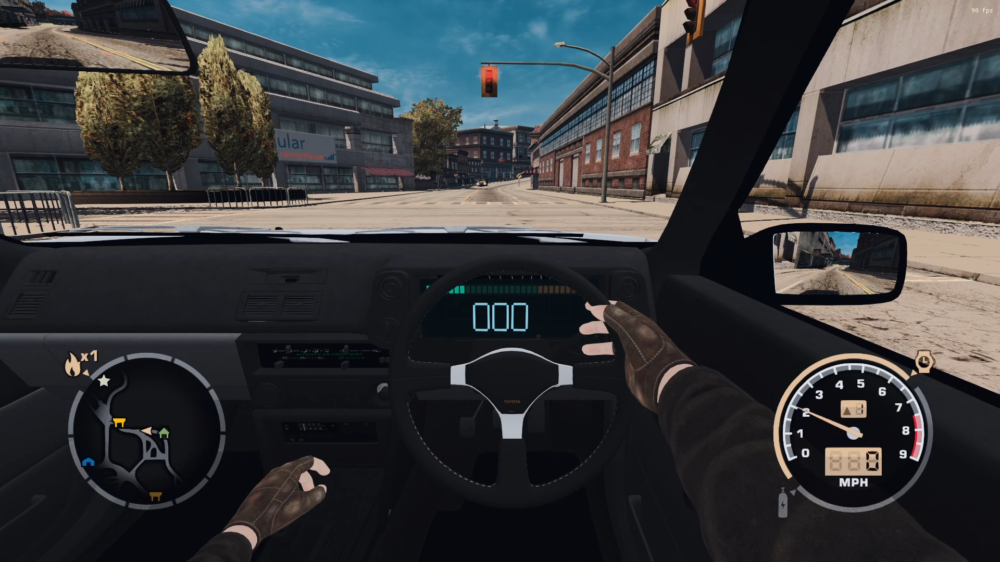

[]([https://youtu.be/cgv5bhlVUgI])


# Toyota AE86 Interior for NFS Most Wanted (2005)

This mod adds an interior view featuring smooth head movement, an animated steering wheel and driver’s hands, reflections in two mirrors, and a dashboard with a speedometer and tachometer.

## Requirements

- **Need for Speed: Most Wanted (2005) for Windows**. The mod has been tested on the Classic Edition build with `speed.exe` SHA-256 `B04CD974BB8B4CDCA9D656E3CE1751B643D2C2EDC633C03B17FBF48B6CE97EA4`. Compatibility with other executable files has not been tested.
- **Ultimate ASI Loader, Win32 version**: [official page](https://github.com/ThirteenAG/Ultimate-ASI-Loader). If there is already a working `dinput8.dll` from this loader in the game folder next to `speed.exe`, a second copy is not needed.

## Installation

1. Close the game.
2. If ASI Loader isn’t already installed, download **Win32 `dinput8.dll`** from the official page and place it in the game folder next to `speed.exe`. Do not replace the existing loader unless necessary.
3. Open the archive and copy the `scripts` folder to the game folder next to `speed.exe`. Confirm the folder merge. The file should end up at the path `...\Need for Speed Most Wanted\scripts\MWUniversalCockpit.asi`.
4. Launch the game and press the **C** key to switch to the bumper view—the interior will appear in this mode.

If the cockpit does not appear, check that `dinput8.dll` is present next to `speed.exe`, that all `ae86_tex_*.png` and `*.mesh` files are in the `scripts` folder, and that the file `scripts\MWUniversalCockpit.log` is present.

## Uninstallation

Close the game and delete only the files listed below from the `scripts` folder. If ASI Loader is used by other mods, leave `dinput8.dll` in place.

```
MWUniversalCockpit.asi
cockpit.mesh
ae86_mirrors.mesh
ae86_tex_0.png
ae86_tex_1.png
ae86_tex_2.png
ae86_tex_3.png
ae86_tex_4.png
ae86_tex_5.png
fp_arms.mesh
fp_arms_1k.png
MWUniversalCockpit-ATTRIBUTION.txt
```

## Authors and Licenses

Made by pumbus2000  /  Toyota AE86 Sprinter Trueno Zenki model: Martin Trafas, [Sketchfab] (https://sketchfab.com/3d-models/toyota-ae86-sprinter-trueno-zenki-a5737bf3cc9b4179a6e5ebe173ff70d9), licensed under [CC BY 4.0](https://creativecommons.org/licenses/by/4.0/). FP arms model: DJMaesen, [Sketchfab](https://sketchfab.com/3d-models/fp-arms-06ee1407117d4e5ab343becb4ee44bb6), licensed under [CC BY 4.0](https://creativecommons.org/licenses/by/4.0/) . Both models have been adapted for in-game display. Mod code: OpenAI Codex. MinHook is used; its license notice can be found in `MinHook-LICENSE.txt`.


